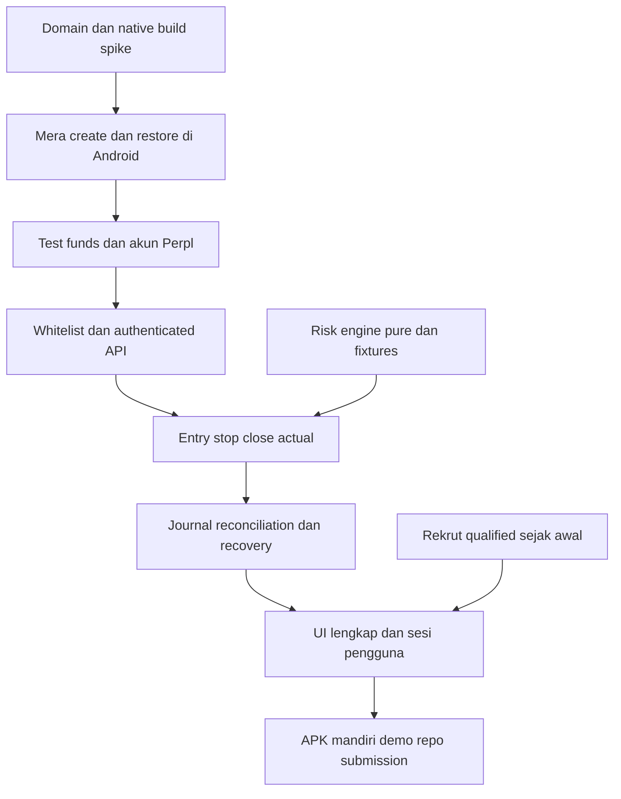

# Tready — implementasi, dependency, dan submission

Versi 0.1 · 11 Oktober 2026. Baseline rencana untuk solo dari nol, Android, testnet. Mengacu ke [PRD](PRD.md), [technical spec](TECHNICAL_SPEC.md), dan [test plan](TEST_PLAN.md). Kemajuan aktual sejak rencana dibuat tersedia di [status implementasi](IMPLEMENTATION_STATUS.md); backlog di sini tetap mendefinisikan target dan bukti selesai.

## 1. Critical path dan anggaran waktu



Estimasi awal 26–36 jam kerja fokus, belum dikalibrasi terhadap throughput founder/build environment. External whitelist, native setup, device provider, atau respons tester dapat mengubah rencana. Tenggat bukan bukti semua dependency pasti selesai.

| Milestone | Budget kerja indikatif | Output/gate | Jika belum tercapai |
|---|---:|---|---|
| M0 Spike integrasi | Maksimal 6 jam pertama | Android PRF/restore, ABI+funding, akses enrollment, satu entry/close | Hentikan polish; selesaikan blocker atau revisi eligibility/scope secara eksplisit |
| M1 Finance/domain | 3–4 jam | BigInt model/constraints, config binding, baseline fixtures | Tidak membuka trade dari kalkulasi yang belum lolos |
| M2 Execution/storage | 6–8 jam | Journal, lifecycle entry/stop/close, reconnect/remaining | Bekukan fitur tambahan; jangan memakai generic mutation retries |
| M3 Android flow | 4–6 jam | Empat layar, lock/resume, error/funding/recovery | Kurangi chart/visual/secondary screens, pertahankan state penting |
| M4 Verification/users | 4–6 jam | P0 traces/device test, lima sesi bila rekrut berhasil | Laporkan hasil aktual; perbaiki misunderstanding/bugs sebelum claim |
| M5 Release/evidence | 3–6 jam | APK, README, license, disclosure, video, portal saved | Tidak menambahkan sponsor/feature di tahap ini |

M0 memiliki gate enam jam, bukan janji entry/close pasti selesai dalam enam jam. Risk work dan recruitment dapat berjalan ketika external enrollment pending; tidak menunggu blocker tanpa mengerjakan tugas independen. Semua perkiraan phase perlu disesuaikan dari hasil spike, bukan dijumlahkan sebagai komitmen delivery.

Deadline resmi 14 Oktober 10:59 WIB. Target freeze/submission 13 Oktober malam WIB; sisakan pagi sebagai buffer pengiriman. [Rules](https://hackathon.monad.xyz/api/v1/policies/current)

## 2. Environment yang ditemukan dan bootstrap yang direncanakan

Read-only inspection workspace: Node `26.10.0`, pnpm `11.4.0`, Java `27`, adb tersedia, system Gradle tidak ditemukan. Android SDK tidak ditemukan di dua lokasi umum yang diperiksa; seluruh kemungkinan lokasi belum diaudit. Source Mera memerlukan Node≥24; baseline RN/Expo perlu toolchain yang cocok.

Gunakan isolated Node24.3+ dan JDK17 sesuai rekomendasi React Native, bukan menganggap Java27 pasti kompatibel. Gradle wrapper berasal dari generated Android project, sehingga tidak wajib system Gradle. Periksa Android SDK via environment/Android Studio; pilih local build bila toolchain tersedia. Jika setup terlalu mahal waktunya, EAS cloud dapat menghasilkan APK, tetapi membutuhkan account/signing/profile serta waktu queue. [React Native environment](https://reactnative.dev/docs/set-up-your-environment), [Expo development builds](https://docs.expo.dev/develop/development-builds/introduction/)

Bootstrap saat implementasi:

1. Pilih stable owned rpId dan package name sebelum credential dibuat. Siapkan assetlinks untuk signing cert yang digunakan.
2. Scaffold Expo native Android; pin candidate dependencies, pnpm workspace dan lockfile. Pindahkan core/adapters ke package yang tidak mengimpor native APIs.
3. Resolve published Mera0.2.0/passkey3.6.1 vs GitHub main/passkey3.6.2; compile dan uji PRF sebelum memakai baseline dalam seluruh app. Kalau perlu source build, pin exact commit serta attribution.
4. Jalankan dependency/native compatibility checks dan typecheck. Expo modules mengikuti `expo install` untuk SDK yang dipilih; tidak menaikkan RN/React ke latest secara terpisah.
5. Development build untuk device, kemudian independent preview/release APK untuk juri. Expo Go tidak membawa seluruh custom native capability/config yang diperlukan.
6. Tangkap real sanitized payloads sebagai fixture. Jangan memasukkan live key ke config file/shell history/source.

Contoh profile EAS yang direncanakan:

```json
{
  "build": {
    "development": { "developmentClient": true, "distribution": "internal" },
    "preview": { "distribution": "internal", "android": { "buildType": "apk" } }
  }
}
```

Preview harus memuat JS bundle dan berjalan tanpa Metro. Jangan mengirim hanya AAB sebagai file yang diminta dipasang langsung pada HP. APK signing certificate yang berbeda wajib memiliki association yang cocok. [Distribusi APK Expo](https://docs.expo.dev/build-reference/apk/)

## 3. Backlog dengan dependency dan bukti selesai

Semua item berikut **planned**; tidak ada tugas yang ditandai selesai hanya karena ditulis di PRD.

| Task | Dependency | Requirement | Bukti selesai |
|---|---|---|---|
| B01 Freeze domain/network choices | — | TR-01–03, TR-06 | Config document dan runtime mismatch handling |
| B02 Native scaffold/lockfile | B01 | TR-31 | Native compile baseline; exact deps tercatat |
| B03 Assetlinks/PRF spike | B01–02 | TR-04–06 | Real-device create/sign-in menghasilkan alamat sama |
| B04 Public config + RPC checks | B01 | TR-01–02 | Token/instance/market/chain resolved; saved sanitized fixture |
| B05 Test funds + owner setup | B03–04 | TR-09–10 | Funding/account/forwarding receipt dan state actual |
| B06 Enrollment/auth spike | B03–05 + whitelist | TR-11 | Owner-wallet key binding; signed read + trading socket |
| B07 Units/input/risk engine | B04 | TR-13–17 | Core tests/grid; quantity/reserve/headroom constraints |
| B08 Local persistence/key storage | B02 | TR-07, TR-20, TR-32 | SQLite transactional journal dan SecureStore separation |
| B09 Transport codecs/inventory | B04, B06 | TR-21–24 | Lossless parsing, snapshots, heartbeat gap/reconnect traces |
| B10 Entry consent/coordinator | B07–09 | TR-18–21 | Payload matches approved plan; double tap/crash cases |
| B11 Linked trigger + verification | B09–10 | TR-22–23, TR-26 | Actual stop registration; missing-stop recovery trace |
| B12 Close/cancel/remaining | B09–11 | TR-24–26 | Close-only actual; unknown/partial remains visible |
| B13 Funding/withdraw completion | B05, B08–12 | TR-12 | Flat-account withdrawal receipt; unsafe state blocked |
| B14 Account/Plan screens | B03–08 | TR-04–19, TR-29–30 | Real device flow dan input/error handling |
| B15 Trade/Receipt screens | B09–13 | TR-21–30 | Actual/projection separation dan provenance |
| B16 Android lifecycle/recovery | B08–15 | TR-07–08, TR-24, TR-27 | Background/force-stop/clear-data outcomes |
| B17 Reconciliation fixtures | B09–15 | TR-28 | No double fee/event counting; missing history labels |
| B18 Qualified recruitment draft/list | — | Product validation | Respons/sesi actual; belum outreach otomatis |
| B19 User sessions + fixes | B14–18 | Product validation | Denominator/tasks/findings dan changed flow |
| B20 P0 verification | B07–17 | TC-01–40 | Passed/failed/blocked dengan actual artifacts |
| B21 Preview/release APK | B02–03, B20 | TR-31 | Fresh install without Metro + checksum/cert |
| B22 README/license/disclosure | Semua implemented modules | TR-33 | Third-party runnable instructions dan attribution |
| B23 Sponsor requirement map | Current cards + B20 | TR-33 | Per requirement: implementation, demo timestamp, chain evidence |
| B24 Demo/pitch/evidence | B19–23 | TR-33 | Public≤3min demo actual; extra pitch bila terkonfirmasi |
| B25 Portal submission review/save | B21–24 | TR-33 | Required fields completed dan submission state verified |

User-facing chart, TP, export/sync, key-management improvements, public web viewer, dan mainnet tidak mendapat task P0. P1/P2 masuk backlog setelah P0 selesai dan temuan pengguna diketahui.

## 4. Pertanyaan dependency yang siap diajukan

Ini draft pertanyaan, **belum dikirim** ke mentor/sponsor. Mengirim pesan membutuhkan instruksi eksplisit terpisah.

Untuk Perpl: “Kami membangun Android native Mera untuk Metropolis. Origin/rpId yang direncanakan: [host milik tim]. Bagaimana mendapatkan whitelist enrollment di testnet? Apakah ada format Origin native yang disarankan? Mohon konfirmasi linked close trigger terhadap partial IOC dan lifecycle stop ketika API key kedaluwarsa/revoked. Apakah expiry membebaskan active-key slot?”

Untuk Agora/Mera: “Apakah Android APK dengan operasi Mera→testnet AUSD→trade Perpl memenuhi mobile bounty? Format distribusi/judge access apa yang diharapkan? Mohon kartu requirements/deliverables/award distribution terkini dan acceptance recovery setelah clear app data.”

Untuk Track01: “Apakah rubric dalam kartu berbeda dari Rules v3? Apakah pitch video≤2menit terpisah wajib, serta bagaimana overall/track/sponsor awards dapat digabung?”

Kalau jawaban tidak tersedia, simpan requirement sebagai unresolved; jangan menggantinya dengan interpretasi repo peserta. Credential manual hanya fallback engineering apabila wallet/account cocok, bukan cara menganggap full mobile onboarding selesai.

## 5. Biaya dan kebutuhan akses

| Kebutuhan | Rencana | Batas keputusan |
|---|---|---|
| Test funds | MON/AUSD testnet dari faucet/transfer token uji | Claim availability/rate/gas diuji; belum ada claim atau biaya trading nyata |
| RPC | Public testnet untuk spike | Rate-limit dan historical block support diuji; upgrade hanya bila perlu |
| Domain association | Owned HTTPS host stabil | Host belum dipilih/dibeli/dideploy; tidak ada asumsi domain tertentu milik user |
| Android build | Local bila SDK/JDK siap; EAS alternatif | Account/queue/signing belum siap; jangan menjanjikan cloud build instan |
| Hosting | Worker static; optional relay | Harga/kuota diperiksa saat dipilih; tidak perlu DB cloud untuk P0 |
| Distribution | APK release/download link dan checksum | Tidak perlu Play Store review untuk APK test; akses juri tetap dikonfirmasi |
| Monitoring/data | Native/local pada P0 | Tidak ada biaya LLM/indexer/always-on keeper yang disembunyikan |

Tidak ada total biaya yang diklaim nol atau pasti karena domain/build account belum diketahui. Pricing provider dapat berubah; cek [Workers pricing](https://developers.cloudflare.com/workers/platform/pricing/) dan [Expo pricing](https://expo.dev/pricing) saat melakukan pembelian/build berbayar. Riset ini tidak membeli layanan.

## 6. Release, rollback, dan mainnet policy

Candidate release memuat git commit, app version/build, schema/model/config version, package ID, cert fingerprint, APK SHA-256, network dan known limitations. Device yang digunakan untuk merekam demo harus memakai build tersebut. Jangan mengganti signing certificate setelah assetlinks disiapkan tanpa memperbarui association.

Freeze native deps ketika spike lolos; perubahan kemudian mengulang affected tests/build. Migration gagal tidak menghapus journal. Rollback mempertahankan SQLite schema compatibility atau menampilkan recovery; merilis versi lama tidak menghapus order yang sudah diterima venue. Turning off new entry tidak sama dengan menutup posisi.

Mainnet writes tetap disabled pada build hackathon. Rencana mainnet membutuhkan pengujian terpisah tentang real liquidity, fee/funding/recycle, supported devices/key management, application security, monitoring availability, dan user demand. Testnet happy path tidak menjadi izin otomatis mengeksekusi uang nyata.

## 7. Submission package dan demo tiga menit

| Deliverable | Isi | Status |
|---|---|---|
| Public repo | Complete implemented code; commit history; OSI license; attribution | Belum dibuat sebagai repo publik |
| README | Setup/build/device/rpId/faucet/API enrollment; architecture; limitations; AI disclosure | Planned |
| APK | Independent Android build + install steps/cert/checksum | Belum dibuild |
| Monad evidence | Actual account/token/exchange/market/tx/fill/position binding | Public reads ada; trade evidence belum ada |
| Demo≤3min | Actual mobile workflow, verified outcome/recovery; replay label | Belum direkam |
| Track pitch | Problem/user/distribution/continuation; additional duration sesuai kartu | Requirement tambahan belum dikonfirmasi |
| Sponsor matrix | Requirement→code→demo→actual evidence; eligibility unresolved terlihat | Planned |
| User findings | Actual participant/task denominators; no fabricated results | Belum ada sesi |

Usulan storyboard: 0:00–0:20 masalah dan budget; 0:20–0:45 Mera/AUSD di HP; 0:45–1:15 review risk/entry bound; 1:15–1:50 actual entry/fill/stop; 1:50–2:20 close atau recovery yang diuji; 2:20–2:40 receipt/chain evidence; 2:40–3:00 identity restore serta actual validation findings. Potong adegan jika durasi melebihi tiga menit, tanpa mempercepat state menjadi klaim yang berbeda.

Rekam clear-data identity recovery ketika aman/flat untuk adegan utama; active-position recovery diuji terpisah dan ditampilkan jika bukti serta waktu cukup. Failure trace yang dibuat sendiri ditandai synthetic replay. Demo bukan pengganti APK/prototype yang beroperasi.

Claim checklist: “Android”, “testnet”, “Mera”, “AUSD”, “trade”, “stop registered”, “recovery”, “actual fees”, “users”, dan “sponsor fit” masing-masing mempunyai evidence. “Production-ready”, “profitable”, “guaranteed max loss”, “world-first”, “lebih cepat dari pesaing”, dan jumlah hadiah tidak dicantumkan tanpa pembuktian tambahan.
