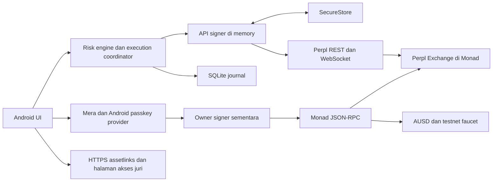

# Tready — Product Requirements Document

Versi 0.1 · 11 Oktober 2026 · Bahasa kerja: Indonesia · Status: spesifikasi untuk implementasi, belum aplikasi yang berjalan.

**Tready adalah aplikasi Android untuk merencanakan trade Perpl dalam budget AUSD, memeriksa hasil eksekusi, dan membantu pengguna memulihkan status trade yang bermasalah.** Rilis hackathon memakai Monad Testnet. Fokusnya satu akun Mera, BTC, satu posisi aktif, dan empat layar.

Kondisi founder: solo, mulai dari nol, punya Android, belum punya calon pengguna. Deadline Metropolis: 14 Oktober 2026 10:59 WIB. Target internal: submission tersimpan 13 Oktober malam WIB. PRD lengkap berarti keputusan dan acceptance criteria lengkap; bukan semua fitur roadmap harus dibangun sebelum deadline.

Dokumen pendamping:

- [Spesifikasi teknis](TECHNICAL_SPEC.md): arsitektur, kontrak domain, hitungan, integrasi, penyimpanan, dan keamanan.
- [Rencana implementasi](IMPLEMENTATION_PLAN.md): dependency, backlog, milestone, build Android, dan submission.
- [Rencana pengujian](TEST_PLAN.md): kasus gagal, testnet, device, pengguna, dan gate rilis.
- [Audit konsep](metropolis-adversarial-review.md): bukti tandingan dan alasan rekomendasi awal direvisi.
- [Daftar sumber](metropolis-sources.json), [observasi dependency](../research/prd/dependency-observations.json), [probe integrasi](../research/prd/integration-probes.json).

## 1. Keputusan utama

| Keputusan | Pilihan | Alasan dan batasnya |
|---|---|---|
| Platform rilis | Android native dengan Expo/React Native | Pengguna punya Android; mengurangi ketidakpastian PWA pada bounty mobile. Penerimaan APK dan akses device juri tetap perlu diperiksa. |
| Network | Monad Testnet, chain 10143 | Pengujian finansial memakai token uji; aturan umum Metropolis mengizinkan testnet. Mainnet write tidak aktif pada rilis ini. |
| Venue | Perpl | Menyatukan eksekusi, AUSD collateral, dan target Agora dalam satu alur. |
| Akun | Mera sebagai asal identitas dan wallet | API key Perpl menjadi capability eksekusi yang diotorisasi wallet tersebut. Tidak ada akun email/password pengganti Mera. |
| Instrument | BTC long/short; satu posisi per akun | Mengurangi state yang harus direkonsiliasi. Entry baru mensyaratkan akun flat, tanpa order lain yang belum selesai. |
| Perilaku | Review → entry berbatas harga → verifikasi → recovery → receipt | Angka rencana harus terhubung ke parameter order dan hasil aktual. |
| Eksekusi | Client menandatangani; venue meneruskan order API | Tready tidak menyimpan wallet/API private key di backend. |
| Storage | SQLite untuk journal; SecureStore untuk API secret | State request harus tahan restart; data signing dipisahkan dari data tampilan. |
| Kontrak baru | Tidak dibutuhkan untuk MVP | Menggunakan kontrak Perpl/AUSD yang sudah ada; jangan menambahkan kontrak dekoratif demi pitch. |
| Scope sponsor | Agora mobile dan Mera UX; Perpl API bersyarat | Setiap claim perlu bukti requirement aktual. Kuru/analytics luas bukan pekerjaan MVP. |

Semua pilihan implementasi adalah keputusan desain. Kesesuaian sponsor belum menjadi fakta sebelum kartu terkini dan bukti implementasinya lengkap.

## 2. Masalah, segmen, dan hipotesis

Segmen pertama: trader perpetual yang sudah memahami entry/stop, memakai HP, dan bersedia mencoba Perpl. Rekrut berdasarkan pengalaman konkret: sizing setelah biaya, mengecek stop, atau kebingungan status order. Jangan mengasumsikan trader pemula membutuhkan leverage atau semua trader ingin pindah venue.

Job pengguna: “Gue sudah punya arah dan invalidasi. Bantu gue mengetahui quantity dan biaya yang masuk akal untuk budget ini, lalu tunjukkan apa yang benar-benar terjadi dan apa tindakan berikutnya.”

Hipotesis masalah:

1. Mengubah budget rugi menjadi quantity dengan fee dan kondisi fill menambah beban hitung.
2. Status submitted/pending/partial/stop registered sulit dipahami ketika koneksi terputus.
3. Pengguna membutuhkan tindakan pemulihan yang spesifik, bukan hanya notifikasi error.

Hipotesis nilai: pengguna dapat menyelesaikan tugas tersebut dengan lebih sedikit salah pengertian dan bantuan dibanding workflow terminal Perpl yang mereka gunakan. Ini belum hasil wawancara, belum traction, dan belum keunggulan kompetitif terukur.

## 3. Dasar riset dan status bukti

| Bukti | Temuan | Dampak pada desain |
|---|---|---|
| Produk pembanding | Fixed Risk sudah ditawarkan Toobit; Desk punya Mera+AUSD+Perpl dan handling order; Night Desk punya executable plan URL. | Jangan mengklaim risk sizing, receipt, atau reliability dasar sebagai penemuan baru. |
| Eksperimen offline Tready | Fee dan gap dapat melewati budget; 360 kombinasi sizing diperiksa. | Tampilkan asumsi dan skenario; jangan menjanjikan hard loss cap. |
| Endpoint publik Perpl | Mainnet/testnet merespons; market/instance/token berbeda antar network. | Resolve config runtime dan binding network secara ketat. |
| JSON-RPC testnet | Chain 10143; bytecode Exchange, AUSD, dan faucet ditemukan; AUSD decimals 6. | Ada deployment yang dapat dibaca, tetapi belum membuktikan claim faucet atau trade berhasil. |
| Docs integrasi Perpl | Enrollment meminta origin whitelist. | Gate sebelum onboarding otomatis, termasuk pada native/backend. |
| Probe HTTP lokal | Context GET sukses tanpa CORS header; OPTIONS enrollment mendapat 404 untuk origin localhost. | Bukan bukti browser integration bekerja. Native tidak membutuhkan browser CORS, tetapi izin origin tetap perlu. |
| Docs Mera + Expo | PRF/provider, domain association, native build, dan penyimpanan secret harus disiapkan. | Device spike dan APK build dilakukan sebelum polish. |

Sumber: [Toobit](https://www.toobit.com/en-US/announcement/get-the-right-position-size-for-every-trade-with-fixed-risk), [Desk](https://github.com/frankolien/desk/blob/main/docs/submission.md), [Night Desk](https://www.definitive.fi/blog/night-desk), [eksperimen](../research/README.md), [Perpl integrations](https://github.com/PerplFoundation/api-docs/blob/main/integrations.md), [Mera mobile](https://github.com/category-labs/mera/blob/main/demos/mobile/README.md). Produk pesaing belum dijalankan; sebagian kode Desk dibaca. Probe bukan authenticated integration test.

## 4. Tujuan dan ukuran keberhasilan

| Tujuan | Ukuran internal | Status saat PRD ditulis |
|---|---|---|
| Alur beroperasi | Satu Android menjalankan Mera → dana testnet → entry → trigger → close → receipt | Belum diuji |
| Hitungan konsisten | Quantity integer, model biaya, arah, dan rounding memenuhi invariant yang ditetapkan | Model Python ada; implementasi TS belum ada |
| Pemulihan andal | Reconnect tidak menghasilkan entry baru yang tidak diotorisasi; posisi tersisa tidak disembunyikan | Belum diuji |
| Akun pulih | Clear app data, pakai passkey yang sama, dapat alamat/account yang sama | Belum diuji |
| Pengguna paham | Minimal 4 dari 5 peserta qualified menjelaskan budget bukan batas rugi terjamin | Belum ada peserta |
| Kebutuhan relevan | Minimal 3 dari 5 menunjukkan pengalaman masalah; minimal 2 mencoba ulang melalui tindakan | Belum terbukti |
| Bisa direview | APK mandiri, repo runnable, bukti chain, dan demo ≤3 menit tersedia | Belum dibuat |

Ambang lima peserta adalah gate internal awal, bukan statistical proof atau rubric sponsor. Profit, volume trading, dan jumlah wallet bukan ukuran utama kualitas risk workflow. Dogfooding tidak dihitung sebagai pengguna eksternal.

## 5. Scope rilis

**P0 — rilis hackathon:** Android, testnet, Mera create/unlock/lock/recovery, saldo MON dan AUSD, funding/account setup, BTC long/short, sizing dengan asumsi biaya/harga, entry IOC, satu stop native Perpl, state posisi aktual, manual reduce-only close, reconnect/reconciliation, local receipt, dan APK/dokumentasi/demo.

**P1 — sesudah P0 beroperasi:** take-profit, export/import rencana, recovery phrase/export akun dengan ceremony tersendiri, saluran key-management yang nyaman, akses read-only dari web, lebih banyak instrument, dan UX pembandingan yang lebih kaya.

**P2 — sesudah kebutuhan terbukti:** encrypted cross-device plan sync, monitoring server yang selalu aktif, subscription/integrator fees, public receipt verifier, dan mainnet rollout setelah validasi terpisah.

Copy trading, signal AI, vault, agent marketplace, multichain, token issuance, market making, lending, dan guaranteed-loss product tidak masuk versi ini. Tidak ada auto-entry atau auto-trim yang melampaui persetujuan pengguna.

## 6. Functional requirements dan acceptance criteria

Semua ID di bawah berstatus **planned**. P0 adalah syarat rilis; P1/P2 tidak menghambat rilis jika dikecualikan dengan jelas.

| ID | Prioritas | Requirement | Acceptance criteria |
|---|---|---|---|
| TR-01 | P0 | Binding testnet | API, RPC chain, Exchange, token, market dan account cocok; mismatch mematikan writes. Tidak ada toggle mainnet write. |
| TR-02 | P0 | Config runtime | Baca decimals, fees, limits dan minimum dari sumber runtime; cache basi tidak menjadi quote baru. |
| TR-03 | P0 | Mode data jelas | Live testnet, replay, dan offline/stale berlabel; replay tidak mempunyai jalur signer. |
| TR-04 | P0 | Mera create/recover | Passkey menghasilkan wallet yang sama dengan derivation v1; create dan existing sign-in merupakan pilihan terpisah. |
| TR-05 | P0 | Capability PRF | Provider tidak mendukung/cancel/error ditangani; tidak mengganti dengan wallet acak atau akun palsu. |
| TR-06 | P0 | Domain Android | Package ID, HTTPS rpId dan SHA-256 certificate dalam asset links cocok untuk APK yang diuji. |
| TR-07 | P0 | Session dan storage secret | Lock mengakhiri signing session; API secret hanya SecureStore + memory; tidak masuk SQLite/log/analytics. |
| TR-08 | P0 | Restore tanpa local plan | Clear-data login memuat state venue; rencana yang hilang ditandai unavailable, bukan direkonstruksi sebagai fakta. |
| TR-09 | P0 | Wallet funding | Saldo MON dan AUSD dibedakan; request faucet/test funding mengikuti status receipt dan saldo aktual. |
| TR-10 | P0 | Setup Perpl | Exact allowance, create account, forwarding dan API enrollment menjadi langkah terpisah dengan progress yang bisa diulang aman. |
| TR-11 | P0 | API enrollment | Wallet signer, key public/secret, origin, chain, scope dan expiry cocok; 409/423 tidak memicu loop enrollment. |
| TR-12 | P0 | Withdraw testnet | Saat akun flat dan tidak ada pending operasi, owner dapat withdraw collateral ke wallet sendiri dengan simulasi dan receipt. |
| TR-13 | P0 | Input rencana | Side, budget, stop, leverage, entry bound, stress exit dan reserve divalidasi; input ambigu/tidak valid menghasilkan alasan spesifik. |
| TR-14 | P0 | Sizing integer | Ukuran lot dibulatkan turun; biaya naik konservatif; hasil tidak melampaui model budget. Quantity nol tidak dapat dieksekusi. |
| TR-15 | P0 | Model biaya | Taker fee kedua leg, reserve funding, recycle/biaya lain yang relevan dibedakan. Nilai belum diketahui tidak diasumsikan nol. |
| TR-16 | P0 | Risk disclosure | Menampilkan loss pada stop dan stress; menyebut gap di luar asumsi; collateral/margin dibedakan dari modeled loss. |
| TR-17 | P0 | Book dan freshness | VWAP memakai depth teramati. Tail tidak terlihat berarti unknown. Quote expired/perubahan material memerlukan review baru. |
| TR-18 | P0 | Admission akun flat | Tidak ada posisi/order lain atau unresolved request; frozen/forwarding/data unknown menahan entry. Affordability memakai semantics yang diverifikasi. |
| TR-19 | P0 | Persetujuan rencana | Parameter yang dikirim berasal dari versi plan yang disetujui. Perubahan side/price/size/fees/account meminta review baru. |
| TR-20 | P0 | Durable request journal | Intent dan request ID disimpan sebelum send; restart/crash tetap dapat merekonsiliasi operasi lama. |
| TR-21 | P0 | Outcome entry | Acknowledgment tidak dianggap fill. Zero/partial/full fill dipisahkan; sisa IOC tidak dikirim otomatis sebagai entry baru. |
| TR-22 | P0 | Trigger terverifikasi | Stop adalah close-only native trigger. Label registered hanya setelah order/position binding dan status diketahui. |
| TR-23 | P0 | Posisi aktual | Quantity, average entry, fee dan position ID berasal dari venue; rencana tidak menimpa quantity aktual. |
| TR-24 | P0 | Reconnect | Tidak ada automatic replacement ketika outcome tidak jelas; request outcome dan inventory order/position direkonsiliasi terpisah. |
| TR-25 | P0 | Close manual | CloseLong/CloseShort dengan konfirmasi parameter; partial/reject/unknown menyisakan state yang jelas. |
| TR-26 | P0 | Recovery proteksi | Jika stop gagal/hilang, tampilkan tindakan check/retry-protection/close sesuai state; tidak menutup diam-diam. |
| TR-27 | P0 | Lifecycle Android | Background/force-stop/resume tidak menjalankan order tertunda otomatis. Resume membutuhkan state fresh sebelum writes. |
| TR-28 | P0 | Receipt | Pisahkan planned/estimated/actual; gunakan event IDs/provenance; PnL net tidak dikurangi fee kedua kali. |
| TR-29 | P0 | Failure UX | Error tidak menghapus bukti request/posisi; pending, remaining, unknown, dan rejected punya tindakan berbeda. |
| TR-30 | P0 | Aksesibilitas mobile | Tidak ada overflow pada lebar 360dp/font besar; target sentuh ≥48dp; status tidak hanya bergantung warna. |
| TR-31 | P0 | APK akses juri | Release/preview APK berjalan tanpa Metro; install/recovery/funding instructions dan checksum tersedia. |
| TR-32 | P0 | Observasi aman | Event lokal cukup untuk mengukur funnel/latency; log menggunakan allowlist dan tidak memuat signature/secret. |
| TR-33 | P0 | Submission evidence | Repo publik/lisensi/disclosure/dokumentasi/video dan chain evidence sesuai requirement terkonfirmasi. |
| TR-34 | P1 | Export/import plan | File versioned tanpa secret; integritas/format diverifikasi; import tidak menyetujui order baru. |
| TR-35 | P1 | Account export | Ceremony terpisah dan user action eksplisit; seed/private material tidak menjadi isi receipt. |
| TR-36 | P2 | Monitoring background service | SLA, key scope, availability dan recovery diverifikasi sebelum klaim always-on. |

Kasus pengujian untuk TR-01–TR-36 tersedia di [TEST_PLAN.md](TEST_PLAN.md). Backend/SDK fields bukan copy UI; pengguna melihat akibat dan tindakan yang relevan.

## 7. Information architecture dan desain empat layar

| Layar | Informasi utama | Tindakan utama | State penting |
|---|---|---|---|
| Account | Network, wallet, saldo MON/AUSD, status akun Perpl dan unlock | Create/sign-in, test funds, setup, deposit, withdraw, lock | Unsupported provider, insufficient gas, setup pending, key expiry, account mismatch |
| Plan | Side, invalidasi, budget, quantity, margin, biaya, stop/stress estimate | Review lalu confirm | Empty input, invalid stop, insufficient collateral, stale/unknown book, changed quote |
| Trade | Entry progress, fill aktual, sisa posisi, stop registration, koneksi | Recheck, protection repair, close | Pending, zero fill, partial, registered, trigger missing, reconnect, close remaining |
| Receipt | Rencana tersedia/tidak, actual fill/fee/funding, recovery timeline, bukti chain | Open explorer, export pada P1, start next plan saat flat | Partial history, incomplete reconciliation, restored-without-plan |

UI memakai bahasa Indonesia, angka tabular, unit AUSD/BTC/MON eksplisit, dan network pill permanen. Editing angka tidak memakai pemisah ribuan; satu `.` atau `,` dapat dinormalisasi sebagai desimal, format ambigu ditolak. Locale display tidak mengubah raw unit.

Tombol confirm memperlihatkan side, quantity, margin, fee, entry limit dan asumsi loss pada satu review. Setelah submit, jangan memakai toast “trade berhasil” sebelum fill diketahui. Pesan yang diusulkan: “Order dikirim”, “Terisi sebagian”, “Stop terdaftar”, “Status belum terkonfirmasi”, atau “Masih ada posisi … BTC”.

Ukuran target sentuh internal ≥48dp. Target layout 360–430dp, safe areas Android dan keyboard handling. Warna netral gelap dengan kontras teks yang diuji; long/short tetap punya label. Tidak perlu candlestick/chart penuh untuk menyelesaikan tugas P0. Animasi tidak menghambat konfirmasi atau menutupi error.

## 8. User journeys

**Pertama kali:** pilih create atau existing passkey → capability check → wallet Mera → test MON/AUSD → exact approve → create Perpl account → forwarding → enrollment → snapshots → ready. Setiap transaksi memiliki receipt; langkah berikutnya menunggu state yang dibutuhkan.

**Trade:** pilih side dan invalidasi → budget, leverage dan asumsi → sizing → review → persist plan/intent → bounded IOC entry → verifikasi fill → verifikasi/pasang trigger terkait posisi → active trade. Entry dan stop tidak dianggap satu transaksi atomik.

**Close:** refresh posisi/order → review quantity/slippage → persist close intent → close-only send → periksa sisa posisi → cleanup/reconcile trigger → receipt. Respons unknown tidak berarti aman mengirim close dengan ID baru.

**Resume/recovery:** hentikan writes → unlock jika perlu → muat journal → koneksi/snapshots/history → klasifikasi outcome → tampilkan posisi aktual → baru izinkan tindakan. Tidak ada order yang ditaruh dalam offline queue untuk dikirim saat sinyal kembali.

**Clear app data:** passkey existing → wallet yang sama → enroll key baru jika local secret hilang dan venue mengizinkan → load venue state. Plan lama tetap unavailable kecuali pengguna mempunyai backup. Key limit/whitelist tidak disembunyikan sebagai error umum.

## 9. Kontrak risiko produk

Budget adalah target kerugian dalam **model dengan asumsi**, bukan asuransi, janji profit, atau hard cap. Harga stop menentukan kondisi pemicu; harga fill penutup bergantung pada eksekusi. Model stress exit tidak menjamin likuiditas di harga tersebut. Close IOC berbatas slippage bisa menyisakan posisi.

Risk engine menghitung paling besar quantity lot yang memenuhi budget pada assumed adverse entry/exit, biaya kedua leg dan reserve. Quantity akhir juga perlu lolos margin, liquidation headroom, limit market dan admission akun. Jika quantity harus turun karena collateral, jelaskan sebabnya. Jangan menggeser invalidasi agar quantity tampak lebih menarik.

Contoh riset budget 5: fee-aware quantity memberi model loss sekitar 5 pada stop, tetapi sekitar 7,96 saat exit bergeser 10 bps. Sizing dengan entry/exit buruk yang diasumsikan dapat memenuhi model, namun masih melampaui budget ketika batas asumsi dilewati. [Eksperimen yang dapat direproduksi](../research/README.md)

Biaya actual pada testnet harus direkonsiliasi dengan config testnet. Snapshot BTC menunjukkan recycle fee 100.000 raw AUSD = 0,1 AUSD, sedangkan mainnet nol. Jangan menambahkan biaya yang kemudian direfund sebagai realized expense. Asumsi funding/holding window tidak boleh dipasarkan sebagai prediksi funding.

## 10. Arsitektur produk

Risk engine pure TypeScript tidak mengenal UI, passkey, network call atau DB. Execution coordinator menjadi satu tempat yang boleh mengubah trading state dan mengirim command. UI membaca view model, bukan menandatangani langsung dari setiap komponen. API signer dan owner signer punya fungsi berbeda.

MVP tidak memerlukan database cloud atau operator yang menyimpan key pengguna. Hosting dipakai untuk Android domain association dan instruksi/APK link. Jika relay enrollment dibutuhkan, endpoint hanya meneruskan payload/signature yang dibuat client; tetap membutuhkan whitelist resmi dan tidak memegang private key. Tidak ada server always-on monitoring pada P0.

## 11. Tech stack yang dipilih

Versi berikut adalah **candidate baseline**, bukan lockfile yang sudah teruji. Pilihan native mengikuti versi yang dipakai demo mobile Mera dan metadata package yang dibaca, bukan menggabungkan semua `latest`.

| Lapisan | Pilihan | Versi/baseline | Peran |
|---|---|---|---|
| Toolchain | Node + pnpm | Node 24.3+ pada line 24; pnpm exact dipin saat bootstrap | Memenuhi Mera/RN; build reproducible |
| Mobile | Expo + React Native + React | 57.0.26 / 0.86.3 / 19.2.8 | Native Android dan native modules |
| Bahasa | TypeScript strict | 6.0.3 baseline demo; evaluasi 7 setelah spike | Domain contracts dan pemeriksaan tipe |
| Passkey | @category-labs/mera | 0.2.0 published | PRF/account derivation dan signing sessions |
| Native passkey | react-native-passkey | 3.6.1 untuk published Mera; main repo memakai 3.6.2 | Android WebAuthn client; perbedaan peer harus dituntaskan |
| Chain client | viem | 2.57.4 candidate | Reads, simulation, owner transactions, EIP-712 |
| API signing | @noble/ed25519 + @noble/hashes | 3.2.0 / 2.4.0 | Ed25519 dan hashing; konfigurasi RN diuji |
| Derivation | @scure/bip32, @scure/bip39 | Pin sesuai observasi dan uji Mera | Mapping EVM wallet stabil |
| Angka | BigInt fixed point + lossless-json | Native BigInt / 4.3.1 | Tidak memakai floating point untuk keputusan uang |
| Validation | Zod | 4.6.5 candidate | Input, internal schemas, boundary decoding |
| Navigation | React Navigation native/native-stack | 7.5.0 / 7.20.0 candidate | Empat layar tanpa menambahkan web framework |
| UI | React Native primitives + StyleSheet | Sesuai RN baseline | Form, review card, state/error display |
| Query/cache | TanStack Query | 5.104.1 candidate | Data reads; bukan retry engine untuk order writes |
| Local DB | expo-sqlite | 57.0.4 candidate | Journal, plan, receipts, checkpoints |
| Secret storage | expo-secure-store | 57.0.4 candidate | API key secret dengan device authentication |
| Random/crypto bridge | expo-crypto | 57.0.3 candidate | CSPRNG dan polyfill bootstrap sesuai referensi |
| Tests | Vitest untuk core; Jest Expo + RN Testing Library untuk UI | Pin saat bootstrap | Angka, coordinator traces, komponen/lifecycle |
| Hosting kecil | Cloudflare Worker static assets | Wrangler candidate 4.149.0 | Asset links, release information; Hono hanya bila ada route relay |
| Android build | Expo native build; EAS APK bila perlu | Profile development dan preview/release | Dev client untuk kerja; APK mandiri untuk juri |

Sumber versi: [observasi registry](../research/prd/dependency-observations.json), [package demo Mera](https://github.com/category-labs/mera/blob/main/demos/mobile/package.json), [package library Mera](https://github.com/category-labs/mera/blob/main/library/package.json). `pnpm-lock.yaml`, native compile dan device run menjadi bukti kompatibilitas sesungguhnya.

Tidak menambahkan Next.js, Prisma, Postgres, Redis, Foundry/Rust runtime, atau analytics SDK ke MVP. ABI resmi dipakai lewat viem; Rust SDK menjadi sumber/reference, bukan dependency executable aplikasi. SQLite lokal cukup untuk single-device prototype. Infrastruktur sync/indexer baru diperlukan saat fitur yang membutuhkannya masuk scope.

## 12. Keamanan dan operasi

Wallet dari Mera adalah software key yang diturunkan dari PRF, bukan klaim hardware-backed wallet signing. Private key yang berasal dari PRF tidak dikirim ke backend. Session lifetime dan transaction allowlist merupakan policy aplikasi, bukan batas yang otomatis ditegakkan Mera atau kontrak. [Security model Mera](https://mera.category.xyz/concepts/security-model/)

Owner signer hanya untuk chain/account/token/spender/action yang dipilih pengguna. API key trade tidak boleh withdraw melalui API, tetapi dapat menimbulkan kerugian lewat trading. App lock mengakhiri sesi lokal, tidak sama dengan revoke API key atau mematikan forwarding onchain.

Secret masuk SecureStore; PRF root tidak dipersist pada desain P0 ini. Metadata wallet dan journal dapat disimpan tanpa secret. Jika secret lokal invalid/hilang, gunakan passkey untuk memulihkan identitas dan otorisasi key baru; jangan membuat identitas lain secara diam-diam. Recovery seluruh riwayat plan lintas device berada di P2.

Target internal freshness quote 3 detik dan heartbeat/account inactivity 5 detik, dievaluasi pada spike. Ini bukan SLA venue. App resume selalu resync. Public market reads boleh retry dengan backoff; mutating commands mengikuti outcome journal. Schema migration gagal harus mempertahankan data dan masuk recovery, bukan reset diam-diam.

## 13. Non-functional requirements

| Aspek | Target internal dan verifikasi |
|---|---|
| Ketepatan | Tidak ada kehilangan integer precision; unknown tidak menjadi nol; replay tidak menjadi actual. |
| Respons UI | Interaksi lokal tetap responsif; risk calculation target p95 <50ms pada device uji, dengan input dan sample count dicatat. |
| Latency eksekusi | Ukur submit→ack, submit→fill dan fill→trigger confirmed; tidak mengutip kecepatan chain sebagai latency seluruh app. |
| Persistensi | Intent tersimpan sebelum send; crash/restart tidak menghilangkan unresolved operation. |
| Ketersediaan | Ketika network/auth/data bermasalah, entry berhenti dan state terakhir diberi label; existing exposure tetap terlihat. |
| Privacy | Event lokal memakai allowlist; tidak mengumpulkan contact/email atau secret untuk menyelesaikan trade. |
| Akses | APK + video + public repo; startup tanpa Metro pada APK yang dibagikan. |
| Reproducibility | Exact lockfile, source attribution, versioned schemas, config examples, and fixtures. |
| Portabilitas | Core dapat diuji tanpa Android dan tanpa signer; UI native menjadi adapter. |

## 14. Validasi pengguna dan distribusi

Mulai rekrut ketika spike berlangsung. Draft outreach dan protokol lima sesi ada dalam [audit](metropolis-adversarial-review.md). Belum ada pesan yang dikirim.

Sesi membandingkan empat tugas: sizing setelah biaya, memahami stress gap, menemukan status setelah reconnect, dan memahami remaining quantity. Baseline memakai terminal/workflow nyata peserta; urutan dibalik antar peserta untuk mengurangi bias belajar. Test failure yang diinjeksi diberi label.

Catat undangan/respons/sesi qualified, task completion, bantuan, waktu, pemahaman budget, dan tindakan mencoba ulang. Jangan menghitung visit, feedback teman tanpa pengalaman perp, atau account test buatan sendiri sebagai permintaan pasar. Saluran awal dipilih setelah mendapat respons; tidak ada partnership komunitas yang diklaim.

Bisnis awal masih hipotesis. Versi hackathon tidak mengambil builder fee. Pilihan pascarilis: workflow subscription atau integrasi engine bagi aplikasi finansial, diuji lewat willingness to pay. Setiap biaya baru mengubah model risiko dan membutuhkan persetujuan serta validasi.

## 15. Target track dan sponsor

| Target | Posisi PRD | Bukti yang dibutuhkan |
|---|---|---|
| Track 01 | Produk utama untuk trader, dengan eksekusi finansial nyata | Problem/target user, prototype, chain interaction, engineering/recovery, bukti penggunaan |
| Agora mobile | Prioritas bersyarat | Android/Mera/AUSD/Perpl sesuai kartu; actual phone flow; pastikan APK/testnet memenuhi brief |
| Mera UX | Prioritas bersyarat | Identity, session UX, clear-data restore, device/provider compatibility, prompt/first-tx measurements |
| Perpl API | Tambahan bersyarat | Requirement automation/reliability/risk dan bukti aktivitas yang sesuai; workflow ini belum otomatis memenuhi seluruh brief |

Nominal publik: Agora mobile $10.000, Mera UX $2.500, Perpl API $5.000 pool. Catatan peserta melaporkan pool Perpl dibagi dua award; kartu terkini belum dibaca langsung. Jangan menganggap nominal tersebut pendapatan pasti. [Landing](https://monad.xyz/developers/hackathons/metropolis), [catatan peserta](https://github.com/ProofBook-App/proofbook/blob/main/docs/reference/hackathon.md)

Rules resmi memberikan lima dimensi main-track masing-masing 20%; sponsor menaruh 40% pada adherence. Repo publik berlisensi OSI, atribusi/disclosure AI, working prototype, dokumentasi, dan demo maksimal tiga menit wajib; mainnet/testnet boleh. Kartu Track 01 dilaporkan memiliki rubric/deliverable tambahan yang masih perlu konfirmasi. [Rules v3](https://hackathon.monad.xyz/api/v1/policies/current)

## 16. Gate integrasi dan keputusan saat gagal

| Gate | Yang harus dibuktikan | Fallback/keputusan |
|---|---|---|
| G1 Domain + Android | RP host, certificate association, PRF, restore alamat | Perbaiki association/provider. Web fallback hanya jika device gagal dan sponsor menerima, dengan perubahan scope eksplisit. |
| G2 Build/distribution | Native modules compile; APK mandiri dapat dipasang | Local toolchain atau EAS. Jangan menganggap Expo Go menggantikan native build. |
| G3 Enrollment | Origin whitelisted; owner/account cocok; signed read dan trading socket berjalan | Key UI hanya untuk engineering dengan wallet/account yang cocok; bukan pengganti otomatis Mera/Agora. Direct-contract route perlu desain/test ulang. |
| G4 Funding/account | Faucet/transfer token yang benar; minimum; account/forwarding | Baca actual receipt/balance. Tidak memakai token README lama atau screenshot faucet sebagai bukti funding. |
| G5 Financial semantics | Unit, fee, recycle/reserve, margin/headroom dan flat-account balance diverifikasi | Block entry bila data material unknown; kurangi claim analytics, bukan menebak equity. |
| G6 Execution | Entry, stop, close, partial/zero fill dan request journal bekerja | Bekukan fitur; jangan submit simulator sebagai aplikasi trading. |
| G7 Recovery | Resume/disconnect, trigger lifecycle dan API-key expiry diuji | Nyatakan fitur yang gagal dan perbaiki sebelum claim reliability/production readiness. |
| G8 Sponsor/platform | Kartu terkini, Android/APK/testnet, deliverables, award split | Keluarkan bounty yang belum dapat dipenuhi; general-track eligibility tetap dinilai terpisah. |
| G9 Pengguna | Qualified pain dan task outcome | Laporkan dogfooding saja bila tidak ada peserta; jangan klaim traction. |
| G10 Submission | Video/repo/license/README/addresses/hashes akses publik | Selesaikan sebelum buffer deadline; tidak menambah sponsor pada malam terakhir. |

Whitelist atau sponsor confirmation tidak didapat dengan mengubah header untuk melewati pembatasan. Pertanyaan siap kirim ada pada rencana implementasi; belum dikirim.

## 17. Definition of done dan roadmap

P0 selesai setelah semua acceptance criteria P0 punya bukti yang cocok, test suite domain/coordinator berjalan, happy path dan recovery penting lolos pada Android nyata, APK mandiri tersedia, serta submission evidence lengkap. Checklist harus menyimpan status actual, bukan centang berdasarkan adanya kode.

Kebutuhan pengguna dan kesesuaian bounty adalah gate kompetitif tambahan: aplikasi berfungsi tidak otomatis berarti produk dibutuhkan atau menang. Claim production-ready, profitabilitas, unique/world-first, guaranteed loss, dan sponsor eligibility tidak dipakai tanpa bukti masing-masing.

Sesudah hackathon: minggu pertama memperbaiki temuan peserta dan key management; minggu kedua menguji return usage; minggu ketiga memperluas satu market hanya bila core stabil; minggu keempat mengevaluasi monetisasi/mainnet berdasarkan data nyata. Ini usulan roadmap, bukan komitmen partnership atau revenue.

PRD ini menjadi sumber keputusan produk terkini. Detail protocol/schemas berada di spesifikasi teknis; perubahan terkait uang, signing atau recovery harus memperbarui requirement, test case, dan claim demo bersama-sama.
