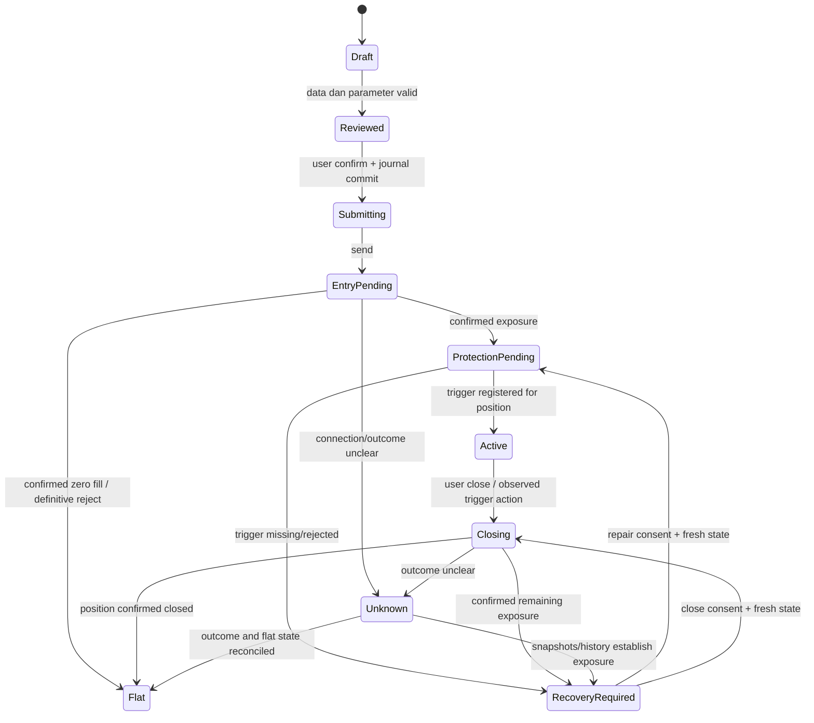

# Tready — spesifikasi teknis

Versi 0.1 · 11 Oktober 2026 · Mendukung [PRD](PRD.md). Semua module/schema/API internal berikut adalah rancangan, belum implementasi. Data observasi disimpan terpisah dari target perilaku aplikasi.

## 1. Struktur repository yang direncanakan

```text
apps/
  android/                 Expo app, navigation, screens, platform adapters
  access/                  assetlinks, install instructions, optional Worker
packages/
  domain/                  schemas, binding, units, risk model, plan fingerprint
  perpl/                   REST/WS codecs, auth, config, request/inventory reducers
  wallet/                  Mera identity, owner policy, API signer lifecycle
  execution/               coordinator, journal protocol, recovery, receipt builder
  storage/                 SQLite repository + SecureStore adapter
fixtures/
  perpl/                   sanitized captured payloads + synthetic failure traces
docs/                      PRD, tests, decisions, submission evidence
research/                  existing offline model; never a source of live quotes
```

pnpm workspace, exact package pins dan lockfile. Hindari monorepo build orchestrator tambahan untuk lima paket kecil. Domain/perpl/execution dapat berjalan di Node test runner tanpa mengimpor Expo. Native deps hanya pada Android/platform adapters. Module signing tidak diekspor ke arbitrary UI components.

P0 tidak membuat smart contract baru. ABI Perpl dipin dari commit SDK `78ce8a06e39e2f9288792eba41aca5f3c08c1195`; catat source/license/hash jika dicopy saat implementasi. [ABI resmi](https://github.com/PerplFoundation/dex-sdk/blob/78ce8a06e39e2f9288792eba41aca5f3c08c1195/crates/sdk/abi/dex/Exchange.json)

## 2. Network configuration dan startup checks

Observasi 11 Oktober, bukan konfigurasi yang harus terus di-hardcode:

| Field | Testnet P0 | Mainnet reference/read-only |
|---|---|---|
| Chain | 10143 | 143 |
| REST base | `https://testnet.perpl.xyz/api` | `https://app.perpl.xyz/api` |
| WS base | `wss://testnet.perpl.xyz` | `wss://app.perpl.xyz` |
| RPC | `https://testnet-rpc.monad.xyz` | `https://rpc.monad.xyz` |
| Exchange instance ID | 12 | 1 |
| Exchange | `0x1964c32f0be608e7d29302aff5e61268e72080cc` | `0x34b6552d57a35a1d042ccae1951bd1c370112a6f` |
| AUSD | `0xa9012a055bd4e0edff8ce09f960291c09d5322dc` | `0x00000000efe302beaa2b3e6e1b18d08d69a9012a` |
| Collateral decimals | 6 | 6 |
| BTC market / perpetual ID | 16 / 16 | 1 / 1 |
| Minimum account opening | 100 AUSD | 10 AUSD |
| Minimum further deposit | 10 AUSD | 10 AUSD |
| Minimum withdrawal | 0,01 AUSD | 0,01 AUSD |
| BTC price / size decimals | 1 / 5 | 1 / 5 |
| BTC base taker fee | 345 micros = 3,45 bps | Sama pada snapshot |
| BTC recycle fee | 100.000 raw AUSD = 0,1 AUSD | 0 |

Sources: [testnet context](https://testnet.perpl.xyz/api/v1/pub/context), [mainnet context](https://app.perpl.xyz/api/v1/pub/context), [Monad testnet](https://docs.monad.xyz/developer-essentials/testnet). Saved [testnet](../research/prd/testnet-configuration.json) dan [mainnet](../research/prd/mainnet-configuration.json). Runtime dapat berubah.

Startup: validasi public context → cek RPC chain → resolve instance/collateral/market → baca token decimals/code → simpan config digest → baru mengaktifkan signer. API `marketId` dan contract `perpetualId` disimpan sebagai field berbeda walau BTC snapshot kebetulan sama. Instance ID bukan account ID. BTC testnet bernama “BTC Perp”; jangan resolve dengan exact nama “BTC” saja.

Alamat testnet lama di tabel README Perpl tidak dipakai. Mismatch deployment/contract version masuk `NETWORK_MISMATCH` atau `CONFIG_UNSUPPORTED`, bukan fallback diam-diam. `config.at` menunjukkan waktu perubahan config; usia quote memakai waktu data diterima/snapshot, bukan menganggap config lama otomatis salah.

Environment/public config yang direncanakan: `TREADY_CHAIN_ID`, `TREADY_PERPL_API_BASE`, `TREADY_PERPL_WS_BASE`, `TREADY_RPC_URL`, `TREADY_RP_ID`, `TREADY_ANDROID_PACKAGE`, `TREADY_BUILD_MODE`. Tidak ada private key pada `EXPO_PUBLIC_*`, source, build artifacts metadata, atau `.env.example`.

## 3. Wallet, Android association, dan key lifecycle

**Identitas:** Mera PRF → entropyToMnemonic → mnemonicToSeedSync tanpa mnemonic passphrase → BIP-32 path `m/44'/60'/0'/0/0`, sesuai recipe resmi. Mapping `derivationVersion=1`, rpId, PRF input/salt, wordlist dan path dibekukan; perubahan mapping membuat alamat berbeda dan membutuhkan migration terpisah. Credential metadata membantu memilih passkey; setelah clear data, existing sign-in harus dapat menemukan credential melalui provider tanpa membuat passkey baru. Hal tersebut wajib diuji pada Android pengguna. Jangan menggunakan contoh random seed sebagai wallet produksi. [Mera account recipe](https://mera.category.xyz/recipes/create-passkey-accounts/), [viem adapter](https://mera.category.xyz/recipes/send-a-transaction-with-viem/)

**Native config:** proposal package `xyz.tready.app`; rpId adalah host HTTPS yang benar-benar dikuasai founder. `/.well-known/assetlinks.json` memuat package dan SHA-256 signing certificate dari debug/preview APK yang dipakai. Host tidak redirect dan MIME JSON benar. Keystore lain memerlukan fingerprint association yang cocok. Tidak memakai `mera.category.xyz` sebagai domain aplikasi sendiri tanpa hak/config yang sesuai.

**Dua signer:** owner Mera/secp256k1 untuk account/token/withdraw/enrollment; API Ed25519 untuk authenticated reads dan trading. P0 menyimpan API token+secret di SecureStore dengan device authentication, menggunakan copy in-memory selama session. PRF/root wallet secret tidak disimpan pada P0. Pemulihan identitas dilakukan lewat passkey; key lokal yang hilang memerlukan enrollment baru, bukan pemulihan token API deterministik yang tidak didukung.

Session policy proposal: maksimum 15 menit sejak unlock, lock saat user meminta atau app masuk background. Owner writes tetap memerlukan review tindakan tertentu. Setelah foreground, state venue harus fresh. Expiry lokal mengakhiri signer, menutup authenticated socket dan membersihkan owned buffers; local lock tidak revoke key/forwarding di venue. Tidak ada trade execution di background service.

P0 API key expiry candidate 24 jam, diuji terhadap kebutuhan demo dan lifecycle trigger. Persistensi menghindari key baru pada setiap restart. Perpl mendokumentasikan maksimum 16 active keys; listing/revoke melalui venue UI. Penanganan expiry/423 dan akses pengelolaan key bagi wallet Mera masih perlu dibuktikan. Jangan membuat loop key baru untuk setiap 401. [Enrollment](https://github.com/PerplFoundation/api-docs/blob/main/integrations.md)

Native bootstrap mengikuti pola CSPRNG demo Mera: `expo-crypto` menyediakan secure random sebelum library memakai `crypto.getRandomValues`. Ed25519 menggunakan API yang cocok dengan versi terpilih dan SHA-512 bridge RN; contoh lama `randomPrivateKey` tidak disalin ke library v3. [Polyfill Mera](https://github.com/category-labs/mera/blob/main/demos/mobile/src/polyfills.ts), [noble Ed25519](https://github.com/paulmillr/noble-ed25519)

SecureStore invalid karena perubahan biometric/hapus app menjadi recovery, bukan wallet baru. UI tidak menjanjikan “tidak ada secret tersimpan”: API signing secret ada di device storage. SecretStore bukan perlindungan terhadap runtime/dependency yang sudah menguasai process. Zeroing mengurangi paparan tetapi tidak membuktikan seluruh salinan memory hilang. [Mera security](https://mera.category.xyz/concepts/security-model/), [Expo SecureStore](https://docs.expo.dev/versions/latest/sdk/securestore/)

## 4. Account setup dan test funds

Flow idempotent per langkah, bukan satu transaksi yang diasumsikan atomik:

1. Derive/verify owner wallet. Baca MON, AUSD, allowance dan account existence.
2. Dapatkan test MON melalui [faucet resmi Monad](https://faucet.monad.xyz), atau transfer token uji ke wallet. Faucet page belum diklaim memberi gas secara otomatis ke seluruh user.
3. Resolve faucet AUSD `0xd236c18d274e54faccc3dd9dda4b27965a73ee6c`, verifikasi ABI/network, simulate `requestFunds(address)` lalu user-confirm write. Baca receipt dan perubahan balance; bytecode probe saja bukan success. Deployment Monad dari [Agora](https://docs.agora.finance/developer/contract-deployments); helper contoh [requestFunds](https://docs.agora.finance/instant-settlement/guides/getting-testnet-tokens) menggunakan Sepolia, jadi adaptasi Monad perlu uji tersendiri.
4. Approve exact AUSD amount ke Exchange, lalu simulate/write `createAccount(uint256)` untuk minimum runtime atau amount pengguna. Re-read account; timeout tidak mengirim create kedua sebelum cek hasil pertama.
5. Simulate/write `allowOrderForwarding(bool)` dengan `true`; tunggu receipt. Setelah enrollment/authentication, verifikasi `Account.fw` lewat authenticated snapshot sebelum ready; ABI account read di langkah awal tidak diasumsikan mempunyai field forwarding.
6. Programmatic enrollment dengan whitelisted Origin; validasi wallet/chain/domain yang ditandatangani.
7. Authenticated read + trading socket; load wallet/orders/positions sebelum ready.

Further deposit menggunakan `depositCollateral(uint256)` dan withdrawal menggunakan `withdrawCollateral(uint256)` dari ABI resmi, dengan simulation, allowance bila dibutuhkan, minimum runtime dan self-wallet destination. Tidak memakai function bernama `deposit`/`withdraw` yang ditebak. Withdraw P0 mensyaratkan flat account dan tidak ada unresolved operation; venue masih dapat menolak/rate-limit.

Owner transaction journal membedakan unsigned, signed/sent, confirmed, reverted dan unknown. Setelah response timeout, lookup hash/receipt/nonce/account state sebelum tindakan baru. Gas reserve dalam MON terpisah dari budget AUSD. Broadcast ulang raw tx yang sama berbeda dari menandatangani transaksi baru; tidak ada generic mutation retry.

## 5. Boundary contract dan unit uang

Semua ukuran finansial/ID yang dapat melebihi safe integer direpresentasikan sebagai decimal strings pada storage/JSON internal, sebagai `bigint` di domain. Chain ID dan small enums boleh number dengan bounds. API parsing memakai lossless codec agar raw numeric uint64 tidak terlebih dahulu rusak melalui `JSON.parse` biasa.

```ts
// Internal design, not a literal venue payload.
type IntegerString = string;
type Binding = {
  chainId: number;
  instanceId: IntegerString;
  exchangeAddress: string;
  walletAddress: string;
  accountId: IntegerString;
  collateralAddress: string;
  marketId: IntegerString;
  perpetualId: IntegerString;
};
type Anchored<T> = {
  value: T | null;
  availability: 'known' | 'unknown' | 'stale';
  source: 'rpc' | 'perpl-rest' | 'perpl-ws' | 'replay';
  block: IntegerString | null;
  serverTimestampMs: number | null;
  receivedAtMs: number;
  socketEpoch: string | null;
};
```

Adapters encode numeric fields sesuai protocol yang diverifikasi; tidak mengirim BigInt sebagai quoted string ke field yang belum terbukti menerima string. Jika numeric ID tidak bisa diserialisasi persis, block writes dengan `WIRE_INTEGER_UNSUPPORTED` sampai codec diperbaiki.

`priceRaw / 10^priceDecimals`, `quantityRaw / 10^sizeDecimals`, `cashRaw / 10^collateralDecimals`. Fee micros dibagi `10^6`. Leverage dan margin denominator hundredths **bukan inverse bps**: initial 1500 merepresentasikan max denominator/leverage 15×; maintenance 2500 merepresentasikan denominator 25 atau 4%. Requested leverage `lv` juga hundredths. Actual semantics dan market configuration harus diverifikasi; jangan memakai formula `10000/initial_margin`. [Types](https://github.com/PerplFoundation/api-docs/blob/main/types.md), [margin](https://docs.perpl.xyz/exchange/margin)

## 6. Risk engine deterministic

Inputs: binding/config, side, budget raw AUSD, desired stop, maximum adverse entry, assumed stress exit, requested leverage, fee tier/rate, funding reserve, operational reserve, and quote provenance. Output: quantity, notional, margin, modeled fees/loss, headroom estimate, reasons dan model version. Function pure; tidak mengambil angka dari global price cache.

Untuk normalized price E dan assumed exit X:

```text
long:  adverse = E - X
short: adverse = X - E
loss(q) = adverse*q + entryFee(q,E) + exitFee(q,X)
          + fundingReserve + operationalReserve
```

Dalam fixed-point, dengan price exponent P, size S, collateral C:

```text
priceLossRaw = ceil(qRaw * adversePriceRaw * 10^C / 10^(P+S))
feeRaw       = ceil(qRaw * priceRaw * feeMicros * 10^C / 10^(P+S+6))
marginRaw    = ceil(qRaw * entryPriceRaw * 10^C * 100
                   / (10^(P+S) * leverageHundredths))
```

Rounding-up merupakan model konservatif; settlement rounding actual diverifikasi terpisah. Integer binary search mencari quantity lot terbesar yang memenuhi loss model. Quantity final adalah minimum constraint risk, affordability, market/minimum/size, dan policy one-position. Tidak menerima rebate/funding credit yang belum terjadi sebagai pengurang risk reserve.

P0 selalu taker IOC, sehingga gunakan taker tier aktual. Fee/config/tier berubah menginvalidasi review. Builder fee nol dan tidak meminta builder binding pada P0. Operational reserve harus mempertimbangkan recycle fee/fee lain dari jumlah operasi yang disetujui; kalau repair menambah operasi/biaya, re-review reserve. Biaya refundable dicatat sebagai lock/reserve sebelum diketahui actual charge/refund.

Stress exit merupakan skenario yang disetujui, **bukan limit fill guaranteed**. Actual exit memakai policy slippage venue; gap/nonfill masih bisa menyisakan posisi dan melewati model. Preflight tidak memprediksi order book saat stop nanti. Tidak ada hasil simulasi yang diubah menjadi probability/confidence yang belum dikalibrasi.

Margin/liq headroom menggunakan isolated linear approximation dan config denominator dengan label estimate. Untuk q>0, Ceff adalah collateral yang benar-benar dialokasikan ke posisi, setelah fee/funding adjustment dan reserve yang relevan; bukan seluruh saldo wallet/akun. Semantik alokasi aktual harus diverifikasi. Dengan maintenance fraction m:

```text
long_liq_est  = (q*E - Ceff) / (q*(1-m))
short_liq_est = (q*E + Ceff) / (q*(1+m))
```

Reject jika headroom/model tidak valid, stress/stop melampaui estimated liquidation boundary, atau leverage di luar config. Fee source/funding/mark bisa mengubah headroom; jangan menyebut formula ini harga liquidation venue terverifikasi. Actual fill/position entry residual ikut rekonsiliasi setelah entry, bukan dihilangkan karena display rounding.

Affordability P0 dipersempit: akun flat, no resting/pending order, no unresolved journal. ABI `getAccountByAddr` memberikan balance/locked/position bitmap dalam satu read pada block yang dipilih. Binding dan field semantics diverifikasi di spike. Jangan menamakannya current total equity dari kalkulasi cumulative stats. Jika tidak dapat menentukan dana material secara benar, block entry. API venue tetap authority admission; snapshot preflight dapat berubah setelah read. [Account ABI](https://github.com/PerplFoundation/dex-sdk/blob/78ce8a06e39e2f9288792eba41aca5f3c08c1195/crates/sdk/abi/dex/Exchange.json)

## 7. Quote, plan, dan persetujuan

Plan persisted v1 memuat:

| Kelompok | Field internal |
|---|---|
| Identitas | planId, revision, binding, createdAt, schemaVersion, modelVersion |
| Input | side, budgetCashRaw, stopPriceRaw, entryBoundRaw, stressExitRaw, leverageHundredths, funding/operational reserves |
| Hasil | quantityRaw, estimatedNotional/Margin/Fees/Loss raw, liquidationEstimate, reasons |
| Provenance | configDigest, bookAnchor, accountAnchor, tier, received timestamps, freshness policy |
| Consent | approvedAt, approvedPlanDigest, approvedCommandEnvelope, sessionId |
| Outcome | request links, actual position link, superseded/closed/incomplete flag |

Plan digest adalah hash canonical internal schema versioned; bukan bukti kebenaran financial assumptions, transaction settlement, atau onchain enforcement. Exact command envelope dikonstruksi dari approved revision. Re-quote tidak mengirim order tanpa confirm lagi jika field material berubah.

Target freshness internal: book quote ≤3 detik; account/heartbeat silence >5 detik menahan entry. Tune lewat actual mobile latency; jangan menganggap target tersebut SLA Perpl. Depth top 100 REST tidak menyatakan seluruh tail kosong. WS book update/removal diterapkan sesuai codec; gap/resubscribe mengganti snapshot, bukan menambal data yang tidak diketahui. Unknown tail → no full-size VWAP projection. [Book/snapshots REST](https://github.com/PerplFoundation/api-docs/blob/main/rest-endpoints.md)

## 8. Perpl transport dan authentication

Client memakai dua socket terpisah: public market-data dan authenticated trading. Subscription P0 dibatch satu frame untuk BTC book, market state/config, heartbeat dan funding yang diperlukan. Account/socket updates masuk adapter, kemudian domain events ke coordinator. REST dipakai config/history/recovery, bukan polling seluruh endpoint setiap detik.

Enrollment harus melalui flow resmi dengan owner EIP-712 approval dan proof-of-possession API key. Origin native ditetapkan ke origin aplikasi yang disetujui; header bukan cara melewati whitelist. Relay bila perlu tidak mengubah pesan yang ditandatangani. Enrollment/type-domain response divalidasi chain, wallet, scope/expiry dan deployment sebelum user-sign; field domain yang belum didokumentasikan menjadi spike question.

REST signing mengikuti canonical request-target/body bytes dari docs, dengan fresh timestamp/nonce dan signature dari client. Bedakan REST base prefix dengan signed target; cocokkan melalui authenticated fixture, jangan menebak bahwa `/api` harus ditambahkan atau dihapus. WS menggunakan signed sign-in sebagai frame pertama. Clock skew/key-expiry/scope failure bukan alasan untuk mengulang mutating command secara umum. [Authentication](https://github.com/PerplFoundation/api-docs/blob/main/authentication.md)

Rate policies proposal: satu trading connection per app account; paling banyak satu command aktif pada coordinator; tiga operations satu trade tidak dikirim sebagai retry storm. Perpl docs mencantumkan testnet 60 trading requests/menit dan empat connections per wallet; public market socket 10 requests/menit dan 16 subscriptions. Keepalive/reconnect memakai budget sendiri. REST 429 dibackoff dengan jitter; mutating retries tetap mengikuti journal outcome. [API limits](https://github.com/PerplFoundation/api-docs)

## 9. Execution coordinator dan tiga state machines

Pisahkan **request outcome**, **live inventory**, dan **user workflow**. Dedup request result tidak boleh mematikan pembaruan trigger/posisi sepanjang umur trade.



Request reducer states: prepared/sent/forwarded/definitive-result/unknown; failed result details disimpan. Live inventory reducer keyed by network/account/order/position, dengan anchored updates dan snapshots. UI workflow memakai kedua sumber; HTTP/socket acknowledgment tidak membuat `Active` atau `Flat` sendiri.

Entry default marketable **limit IOC** pada approved maximum price untuk long/minimum price untuk short. Price bound adalah limit entry aktual; IOC zero/partial tidak menjadi order sisanya. Explicit execution-block expiry berdasarkan fresh head dan runtime TTL. Register stop dengan native linked request/position mechanism dan close-only side; trigger `lb=0` mengikuti docs. Pilihan trigger mark/last harus eksplisit dan konsisten dengan rencana; P0 mark setelah diverifikasi.

Cara pemasangan linked stop sebelum/bersamaan dengan entry untuk memperpendek interval tanpa trigger diuji pada spike. Ini tetap beberapa request, bukan atomic bracket. Jika entry fill terjadi dan stop belum terverifikasi, status tetap `ProtectionPending/RecoveryRequired`; UI memberi check, repair, atau close. Scope P0 tidak mengubah stop level otomatis dan tidak melakukan auto-trim.

Stop registry memeriksa binding, direction, trigger condition/price, order status, linked request/position, serta actual exposure. Close* native clamps quantity ke posisi; Tready tidak mengklaim menemukan primitive clamping baru. Label hanya “stop terdaftar”, bukan “rugi pasti ≤budget”. Stop yang terpicu tetapi closing fill partial/nonfill masih membutuhkan remaining-position handling.

## 10. Request journal, retries, dan reconnect

Sebelum send: SQLite transaction mengalokasikan ID dari maksimum local counter dan venue last-forwarded value, menyimpan exact command + plan digest + expiry + connection epoch, lalu commit. Semua sends melalui single-flight queue. Journal persist failure membatalkan send; jangan menjalankan order yang tidak bisa dipulihkan setelah crash.

API at-most-once berlaku per account/request ID; direct-contract order tidak diwarisi semantics ini. Retry hanya sesuai state/protocol: original ID/payload untuk unknown sebelum expiry yang memenuhi syarat; new ID membutuhkan hasil failure yang jelas atau kondisi expiry/continuity yang didokumentasikan. Setelah reconnect/crash, continuity flag selalu false. [Delivery semantics](https://github.com/PerplFoundation/api-docs/blob/main/websocket.md)

Recovery menggabungkan wallet/open orders/open positions, history/fills yang mencakup operasi lama, request journal, dan block anchors. Tidak adanya order pada open-orders endpoint tidak membuktikan order tidak pernah terisi. Tidak adanya satu page history tidak menjadi bukti absent jika pagination belum mencakup rentang request. Jika bukti tidak cukup, state tetap unknown dan tidak mengirim replacement entry.

Wallet snapshot menjadi titik awal heartbeat sequence; gap mematikan new writes dan memicu resync. Late success setelah error/timeout disimpan dan exposure tetap ditangani. First definitive request result dedup mengikuti vendor, sementara inventory/settlement events tetap diperbarui. Trigger waiting→triggered→executed tidak diabaikan hanya karena request registration dahulu sudah definitif.

Close/cancel/repair memiliki journal sendiri. Cancellation acknowledgment belum membuktikan exposure/order hilang. New close membutuhkan fresh remaining quantity dan status operasi penutup sebelumnya. Correctly reduce-only order masih bisa fail. API error `OrderDescIdTooLow` tidak memicu duplicate entry apabila original outcome belum direkonsiliasi; reseed/retry-once hanya untuk command yang terbukti belum ter-forward dan masih diotorisasi.

Jika semua app data dihapus, journal hilang. Pulihkan identity + venue inventory; jangan mengaku bisa merekonstruksi original intent atau exactly-once seluruh operasi lama tanpa bukti. Aktifkan close/check setelah fresh state; new entry membutuhkan review baru dan account flat yang diketahui.

## 11. SQLite dan storage contract

| Table | Key | Isi dan aturan |
|---|---|---|
| accounts | wallet/network/instance | Public binding, derivation version, credential metadata, config reference; no secret |
| plans | planId + revision | Versioned input/quote/consent; tidak diedit setelah approved, buat revision baru |
| request_counter | account binding | Decimal-string last allocated ID; atomic bersama request insert |
| request_journal | account + request ID | Kind, exact command, expiry, epoch, plan link, observed outcome; immutable intent |
| events | domain event key | Sanitized payload + provenance; duplicates tidak dijumlahkan lagi |
| checkpoints | account + stream | Last valid sequence/block, epoch, inventory snapshot, freshness flags |
| receipts | trade/position link | Planned/actual reconciliation dan completeness/provenance |
| measurements | local session + event | Funnel/latency/error code yang di-allowlist; bukan secret/raw auth |

Money/ID besar disimpan TEXT; bound parameters untuk SQL. Table schema version dan migration transactional. Dedupe event memasukkan chain, tx/log ketika tersedia, entity/kind/reason dan per-event identity; satu tx/log dapat memuat dua settlement rows pada inversion, jadi tx/log saja tidak cukup. Captured actual payload menjadi dasar dedupe key, bukan menebak semua events punya tx hash.

SecureStore bundle keyed by chain+wallet+API key identity memuat secret/token/expiry dan metadata minimum. API token tidak masuk public receipt. SQLite bukan vault private key; plan/history lokal bisa dibaca pada device compromise dan tidak diklaim private cloud sync. User sign-out menjelaskan apakah local receipts dipertahankan/dihapus; tidak menghapus passkey provider credential secara diam-diam.

## 12. Receipt dan reconciliation

Receipt memuat binding, plan availability/revision, actual fills/fees, position changes, trigger/close outcomes, source/block/time, transaction link jika diberikan, model assumptions, and completeness. Missing funding/history = incomplete/unknown, bukan nol. Jangan menambah transaction hash contoh untuk event yang tidak menyediakan hash.

Position snapshot adalah standing state; settlement event adalah delta. Adapter mengubah keduanya ke semantic objects sebelum receipt builder menghitung. Total fees dari gross fill, exit cfee dan entry allocation tidak dijumlahkan secara tumpang tindih. Cumulative net realized stats bukan gross PnL untuk dikurangi fee lagi. Reconcile selected trade dari actual settlement events; account-level totals menjadi cross-check dengan scope/time yang sama. [Financial field semantics](https://github.com/PerplFoundation/api-docs/blob/main/types.md)

Plan receipt hash dapat membantu mendeteksi file berubah, tetapi tidak membuat offchain plan menjadi audit proof onchain. Explorer evidence memberi trace transaksi; attribution plan→actual order membutuhkan binding/journal/event data yang cocok.

## 13. Hosting dan API internal

P0 host statis HTTPS untuk `/.well-known/assetlinks.json`, `/install`, `/releases/latest.json` dan link demo/source. APK dapat dibagikan via public release/artifact URL dengan checksum; tidak harus membangun storage service baru. Host/rpId stabil setelah passkey dibuat. [Cloudflare static assets](https://developers.cloudflare.com/workers/static-assets/)

Optional relay contract, hanya bila spike native enrollment memerlukannya:

| Route internal | Fungsi | Constraint |
|---|---|---|
| GET /health | Version/network/build status publik | Tidak memuat key, account data atau sensitive environment |
| POST /enrollment/payload | Forward challenge request resmi | Fixed upstream, chain/scope policy, body limit, approved Origin |
| POST /enrollment/complete | Forward client-signed enrollment | No signing on server; no auth body logging; pass response unchanged |

Proxy bukan bypass whitelist, bukan signer, dan bukan database user. Generic arbitrary upstream forwarding dilarang. Backend hanya Hono/Worker bila routes diperlukan; static association dapat berjalan tanpa server application logic. Native direct REST/WS jadi pilihan awal. Browser harness kemudian perlu relay/CORS yang diuji sendiri.

## 14. Operasi, errors, dan unresolved technical questions

Internal error classes: capability, identity mismatch, network/config, funds, quote expired/unknown, auth/key limit, gateway reject, settlement failure, request unknown, protection missing, remaining exposure, storage/journal, history incomplete. UI mengubahnya menjadi tindakan yang relevan; details tetap tersedia untuk debugging. Raw HTML/error upstream tidak dirender sebagai UI trusted.

Retry public reads/backoff reconnect proposal 0,5→1→2→4 detik dengan jitter dan cap; reset saat connection sehat. Trading ping berjalan sesuai budget; lifecycle adapter memakai React Native AppState. App background menghentikan writes dan tidak mengandalkan timer tetap hidup. App resume selalu resync. Kecepatan retry tidak boleh mengalahkan rate limit atau membuat command baru. [AppState](https://reactnative.dev/docs/appstate)

Pertanyaan spike yang belum terjawab: whitelisted Origin untuk native; actual signed target format; account balance/locked/fee charging semantics; recycle charge/refund pada setiap jenis order; linked stop activation terhadap partial IOC; lifecycle trigger saat API key expires/revokes; mark/last trigger choice; `tif` trigger semantics yang berbeda antar bagian docs; retrieval history pagination dan uint64 wire format; slot active keys sesudah expiry; actual PRF provider pada Android pengguna.

Metadata registry bukan compatibility test. Dokumen ini tidak menyatakan SDK, APK, account onboarding, signing, atau trade sudah berjalan. Implementasi menghasilkan sanitized fixtures dan bukti untuk mengubah setiap pertanyaan menjadi keputusan yang diuji.
